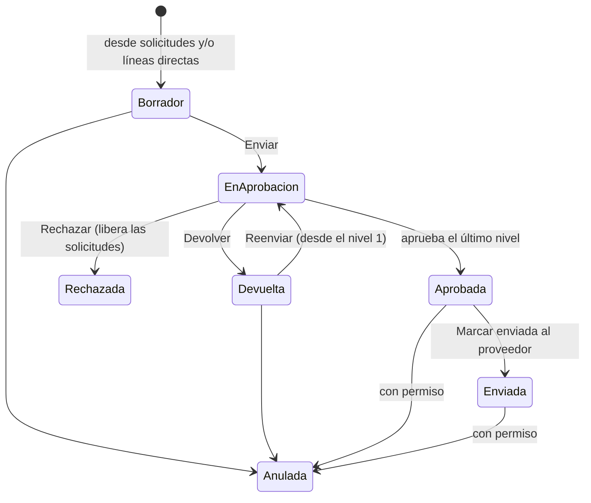

# Órdenes de compra

**Versión:** 0.15.0 · **Estado:** disponible

## 1. Objetivo del módulo

Que Compras emita la orden al proveedor a partir de las solicitudes aprobadas (o de forma directa), con la aprobación que el cliente configura, y la envíe en un PDF con el formato de la empresa.

## 2. Roles y permisos

| Permiso | Permite |
| --- | --- |
| `compras.orden.crear` | Emitir órdenes, editarlas, enviarlas a aprobación y marcarlas como enviadas al proveedor |
| `compras.orden.ver` | Ver todas las órdenes de las empresas y unidades a las que tiene acceso |
| `compras.orden.anular` | Anular órdenes aprobadas o enviadas al proveedor |
| `compras.regla.ver` / `.editar` | Ver y configurar las reglas de aprobación de órdenes |
| `compras.formato.editar` | Configurar el formato PDF de la orden |

**Para aprobar no hace falta un permiso:** aprueba quien la regla designa.

Roles estándar: `ERP_COM_ADMINISTRADOR`, `ERP_COM_COMPRADOR`, `ERP_COM_CONFIGURADOR` y `ERP_COM_CONSULTA`.

## 3. Flujo del proceso

| Estado | Qué significa |
| --- | --- |
| Borrador | Compras la prepara; las solicitudes incluidas ya no están disponibles para otra orden |
| En aprobación | Esperando a los aprobadores del nivel actual |
| Devuelta | Un aprobador pidió corregir algo |
| Rechazada | No procede; sus solicitudes vuelven a *Aprobada* |
| Aprobada | Lista para enviar; el PDF sale sin marca de agua |
| Enviada al proveedor | Se envió; queda la fecha y quién la marcó |
| Anulada | Se dejó sin efecto, con motivo; sus solicitudes vuelven a *Aprobada* |

Los estados de recepción (parcialmente recibida, recibida, cerrada) llegarán con el módulo de recepciones.

## 4. Pantallas y campos

### Órdenes de compra

Pestañas **Por aprobar** (con contador), **Mis órdenes** y **Todas**. La lista muestra proveedor, solicitudes de origen, total, estado y quién la tiene pendiente.

**Cabecera:**

| Campo | Regla |
| --- | --- |
| Proveedor | Activo y no bloqueado para la empresa |
| Contacto | Uno del proveedor; si no se elige, el principal |
| Unidad de negocio | Una a la que el comprador tiene acceso |
| Moneda y condición de pago | Se proponen las del proveedor; se pueden cambiar |
| Fecha y lugar de entrega | Opcionales; la fecha no puede ser anterior a la orden |
| Observaciones | Se imprimen en el PDF |
| Atributos adicionales | Los activos de la orden ([ADR-005](../adr/0005-atributos-adicionales.md)) |

**Solicitudes aprobadas:** se marcan las que entran. Cada una entra **completa**, con todas sus líneas y cantidades (no se piden cantidades parciales). Por cada línea se ajusta el **precio** (se propone el estimado si la moneda coincide) y el **impuesto** (por defecto el de mayor tasa activo, IGV 18 % en Perú). El reparto por centro de costo y los atributos se copian de la solicitud según el mapeo configurado.

**Líneas directas:** artículo, descripción, cantidad, unidad, precio, impuesto, centros de costo (suman 100) y atributos. Sirven para compras sin solicitud.

**Una línea por cada línea de solicitud:** si el mismo artículo viene en dos solicitudes, van en dos líneas para no perder de dónde vino cada una.

**Detalle:** líneas con su origen, totales, *Quién aprobará* antes de enviar, historial de aprobación, y los botones Ver PDF, Editar, Enviar, Anular, Aprobar / Devolver / Rechazar y **Marcar enviada al proveedor**.

### Formato de la orden

Uno por empresa, con **vista previa en vivo** del PDF (datos de ejemplo). Se configura: título, color, tamaño (A4 o carta), bloques de datos por fila, logo propio o el general del ERP, secciones (se activan y se ordenan con ↑ ↓), columnas del detalle, términos y condiciones y pie de página. Detalle técnico en [ADR-007](../adr/0007-pdf-orden-de-compra.md).

### Reglas de aprobación de órdenes

En *Solicitudes → Reglas de aprobación*, pestaña **Órdenes de compra**. Funcionan igual que las de solicitudes ([ADR-006](../adr/0006-motor-de-aprobacion.md)): condiciones (unidad, categoría, tipo de artículo, centro de costo), hasta 3 niveles por monto, en serie o en paralelo, y aprobadores por usuario, rol, responsable del centro de costo o jefe de quien emite la orden.

## 5. Reglas de negocio y validaciones

- Una solicitud solo entra en una orden si está *Aprobada*. Desde que se guarda la orden queda *Atendida* y muestra el número de la orden.
- Al editar una orden en borrador o devuelta, las solicitudes que se quitan vuelven a *Aprobada*.
- Si la orden se rechaza o se anula, todas sus solicitudes vuelven a *Aprobada*.
- Al enviar se verifica de nuevo que el proveedor siga habilitado y se fija la cuenta contable de las líneas directas (perfil del artículo); las líneas de solicitud conservan la que se fijó en la solicitud.
- El monto que decide los niveles es el **total con impuestos** convertido a la moneda de la empresa con el tipo de cambio venta vigente.
- Quien emite la orden nunca la aprueba: su paso se omite.
- Solo quien emitió la orden la edita y la envía; anular una orden aprobada o enviada requiere `compras.orden.anular`.
- El PDF de una orden no aprobada lleva marca de agua con su estado.
- Todo queda en la auditoría: crear, editar, enviar, aprobar, devolver, rechazar, enviar al proveedor, anular, y los cambios del formato.

## 6. Reportes disponibles

- Lista de órdenes por estado, con proveedor, solicitudes de origen y quién la tiene pendiente.
- PDF de la orden.
- Reporte de solicitudes y órdenes en Excel: siguiente entrega.

## 7. Configuración por país

El impuesto por defecto sale de los impuestos de la empresa (en Perú, IGV 18 %; también Exonerado e Inafecto). El documento del proveedor se imprime con su tipo (RUC, DNI o extranjero).

## 8. Preguntas frecuentes

**No veo una solicitud aprobada para incluir.** Ya está en otra orden (mira su número en la solicitud) o es de una unidad de negocio a la que no tienes acceso.

**¿Puedo pedir solo una parte de una solicitud?** No: la orden toma la solicitud completa. Si el proveedor no tiene todo, la solicitante puede registrar otra solicitud por el saldo.

**¿Por qué el PDF dice BORRADOR?** Porque la orden aún no está aprobada. La marca desaparece al aprobarla.

**¿Cómo cambio el logo del PDF?** En *Compras → Formato de la orden*, botón *Subir logo de la empresa*. Si no subes uno, se usa el logo general del ERP.

## Referencia técnica

API: `/api/v1/compras` (órdenes, bandeja, solicitudes disponibles, formato, PDF) y `/api/v1/aprobaciones?documento=orden_compra` (reglas). Tablas `cmp_orden`, `cmp_linea`, `cmp_distribucion`, `cmp_formato`, `cmp_correlativo`.
