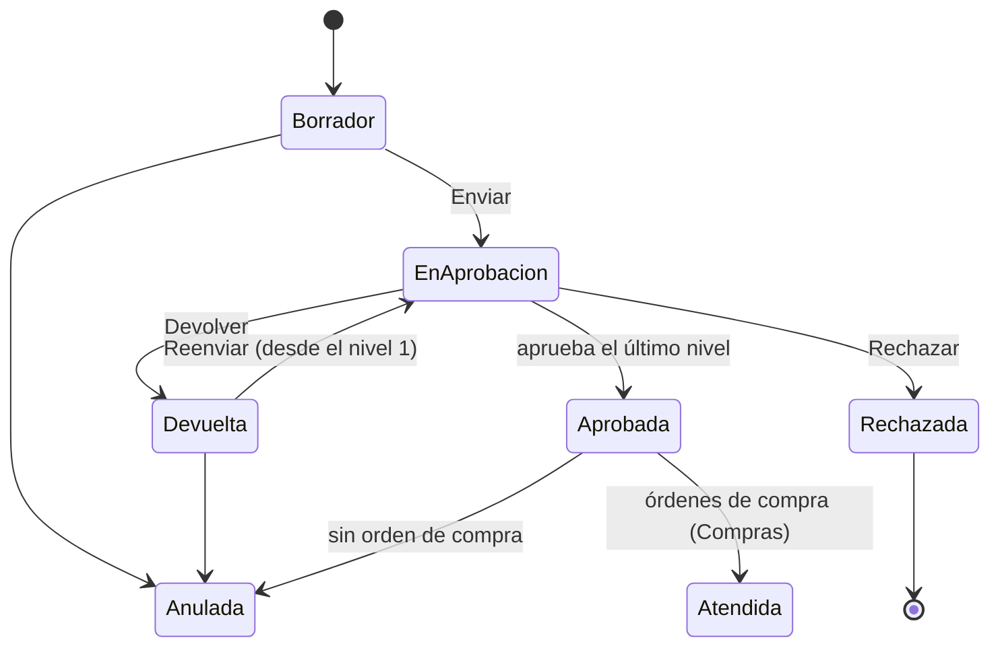

# Solicitudes de compra

**Versión:** 0.14.0 · **Estado:** disponible

## 1. Objetivo del módulo

Que cualquier área pida lo que necesita comprar, con el artículo, la cantidad, el precio estimado y el centro de costo, y que la solicitud pase por las aprobaciones que el cliente configura antes de llegar a Compras.

## 2. Roles y permisos

| Permiso | Permite |
| --- | --- |
| `solicitudes.solicitud.crear` | Registrar, editar y enviar solicitudes propias |
| `solicitudes.solicitud.ver` | Ver todas las solicitudes de las empresas y unidades a las que tiene acceso |
| `solicitudes.solicitud.anular` | Anular solicitudes aprobadas sin orden de compra |
| `solicitudes.regla.ver` / `.editar` | Ver y configurar las reglas de aprobación |

**Para aprobar no hace falta un permiso:** aprueba quien la regla designa. Cualquier usuario ve en *Por aprobar* lo que espera su firma.

Roles estándar: `ERP_SOL_ADMINISTRADOR`, `ERP_SOL_CONFIGURADOR` (reglas), `ERP_SOL_SOLICITANTE` y `ERP_SOL_CONSULTA`.

El módulo se activa en *Administración → Módulos*. El usuario solo ve y registra solicitudes en las empresas y unidades de negocio que tiene asignadas.

## 3. Flujo del proceso

| Estado | Qué significa | Quién actúa |
| --- | --- | --- |
| Borrador | Se está preparando; se puede editar | Solicitante |
| En aprobación | Esperando a los aprobadores del nivel actual (se muestra quién) | Aprobadores |
| Devuelta | Un aprobador pidió corregir algo | Solicitante |
| Rechazada | No procede; es final | — |
| Aprobada | Lista para Compras; ya no se edita | Compras |
| Parcialmente atendida / Atendida | Tiene órdenes de compra por parte o por todo | Compras (semana 5) |
| Anulada | Se dejó sin efecto, con motivo | — |

## 4. Pantallas y campos

### Solicitudes de compra

Pestañas: **Por aprobar** (con contador; muestra las de todas tus empresas), **Mis solicitudes** y **Todas** (con el permiso de ver). Filtro por estado.

**Cabecera:** título, unidad de negocio, fecha requerida, moneda (la de la empresa o USD), justificación y los atributos adicionales activos ([ADR-005](../adr/0005-atributos-adicionales.md)). El número se asigna solo: `SC-2026-000001`, correlativo por empresa y año.

**Línea:** artículo (búsqueda por código, descripción, marca o modelo), descripción (editable), cantidad, unidad (la del artículo o sus alternativas), precio estimado sin impuesto y atributos de línea. Si el artículo tiene precio referencial en la misma moneda, se propone.

**Distribución:** uno o varios centros de costo con su porcentaje; deben sumar 100. El último centro recibe el redondeo para que los montos cuadren al céntimo. Cada reparto tiene sus atributos de distribución.

**Detalle:** líneas con su cuenta contable (se fija al enviar), **Quién aprobará** (vista previa antes de enviar) y el **historial de aprobación** por nivel, con quién actuó, cuándo y su comentario. Los envíos anteriores quedan plegados.

**Botones según el estado:** Editar, Enviar / Reenviar, Anular (pide motivo); para el aprobador de turno: **Aprobar**, **Devolver para corregir** y **Rechazar** (estos dos piden comentario).

### Reglas de aprobación

Por empresa. Lista con prioridad, condiciones y un resumen de cada nivel. Al editar:

| Campo | Regla |
| --- | --- |
| Nombre | Obligatorio |
| Prioridad | Desde 1; única en la empresa. Se evalúa primero la de menor número |
| Se aplica a | Unidad de negocio, categoría (incluye subcategorías), tipo de artículo y centro de costo; vacío = cualquiera |
| Nivel 1 a 3 | **Se activa desde** (monto en la moneda de la empresa; no puede ser menor que el del nivel anterior) y **Modo** |
| Aprobadores | Usuario específico, rol, responsable del centro de costo o jefe del solicitante; cada uno con condiciones opcionales *Solo si…* |

**Ejemplo:** Nivel 1 desde S/ 0, en serie: jefe del solicitante. Nivel 2 desde S/ 5,000, paralelo · basta uno: Gerente de Administración o rol *Aprobador de gerencia*. Una solicitud de S/ 3,000 la aprueba solo el jefe; una de S/ 8,000, el jefe y luego uno de los dos del nivel 2.

### Datos que usan las reglas

- **Jefe inmediato:** en *Administración → Usuarios*.
- **Responsable del centro de costo:** en *Contabilidad → Centros de costo*, ahora es un usuario del ERP.

## 5. Reglas de negocio y validaciones

- Solo se edita en *Borrador* o *Devuelta*, y solo quien la registró.
- Al enviar:
    - cada artículo debe tener perfil contable en la empresa; su cuenta de cargo queda guardada en la línea;
    - el total se convierte a la moneda de la empresa con el tipo de cambio venta vigente; ese monto decide los niveles;
    - si no hay regla aplicable, falta el jefe, un centro no tiene responsable o un rol no tiene usuarios, el envío se bloquea con el motivo.
- El solicitante nunca aprueba su propia solicitud: su paso aparece *omitido*.
- En *paralelo · basta uno*, al aprobar uno los demás quedan *omitidos*.
- Un aprobador por rol debe tener acceso a la unidad de negocio de la solicitud.
- Una solicitud en aprobación no se anula: se pide que la devuelvan.
- Cambiar una regla no afecta las solicitudes ya enviadas: sus aprobadores se fijan al enviar.
- Todo (crear, editar, enviar, aprobar, devolver, rechazar, anular, cambiar reglas) queda en la auditoría.

## 6. Reportes disponibles

- Lista de solicitudes por estado, con quién la tiene pendiente.
- Reporte de solicitudes y órdenes en Excel: semana 5.

## 7. Configuración por país

La moneda de comparación de montos es la moneda funcional de la empresa (PEN en Perú). Las reglas no dependen del país.

## 8. Preguntas frecuentes

**No puedo enviar: "No hay una regla de aprobación".** El administrador de solicitudes debe crear al menos una regla general (sin condiciones) en la empresa.

**¿Qué pasa si el jefe se va de la empresa?** Al desactivar su usuario, las solicitudes nuevas de su equipo no se envían hasta registrar otro jefe. Las que ya esperaban su firma quedan detenidas: la reasignación llegará con los *aprobadores suplentes* (ver [ADR-006](../adr/0006-motor-de-aprobacion.md)). Antes de desactivarlo, pide que las apruebe o devuelva.

**¿Puedo aprobar mi propia solicitud si soy gerente?** No. Tu paso se omite y sigue el siguiente aprobador.

**Devolví una solicitud, ¿la vuelvo a aprobar?** Sí: el reenvío empieza de nuevo en el nivel 1.

## Referencia técnica

Motor de aprobación: [ADR-006](../adr/0006-motor-de-aprobacion.md). API: `/api/v1/solicitudes` (ver `/docs` de la API).
